# The Robotic Craftsman

<p>
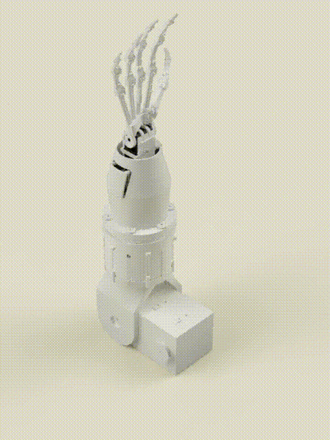
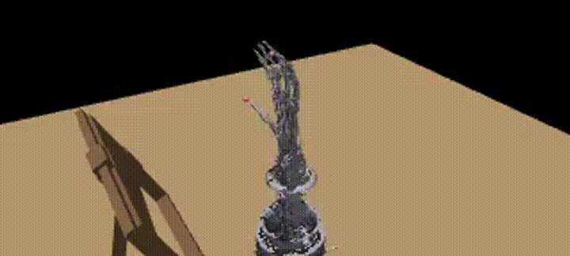
</p>

A robotic arm and tendon-driven hand (Hania) built to reproduce hand-sewing on flimsy fabric. I filmed hand-sewing demonstrations, extracted 3D hand pose with WiLoR, retargeted it onto the robot in MuJoCo, and am now training a policy in simulation to track those demonstrations before transferring it to the real arm. Arm, hand, electronics and code are my own design.

Project page: https://kat2137.github.io/dlugosz-site/

## Status
| Stage | State |
|---|---|
| Footage capture (own demonstrations) | Done: original tripod clips + refilmed one-hand sewing on the frame with a metre stick in shot for scale |
| Pose extraction (WiLoR) | Done |
| Retargeting → MuJoCo replay | Done: fingers, wrist and elbow, checked against footage |
| Real arm | Rebuilt elbow/base, all three ST servos calibrated, pinch switch detects the needle |
| RL policy (MJX + PPO) | In progress: `training/training_mjc.ipynb` |
| Sim-to-real | Next (Isaac Lab) |

<p>
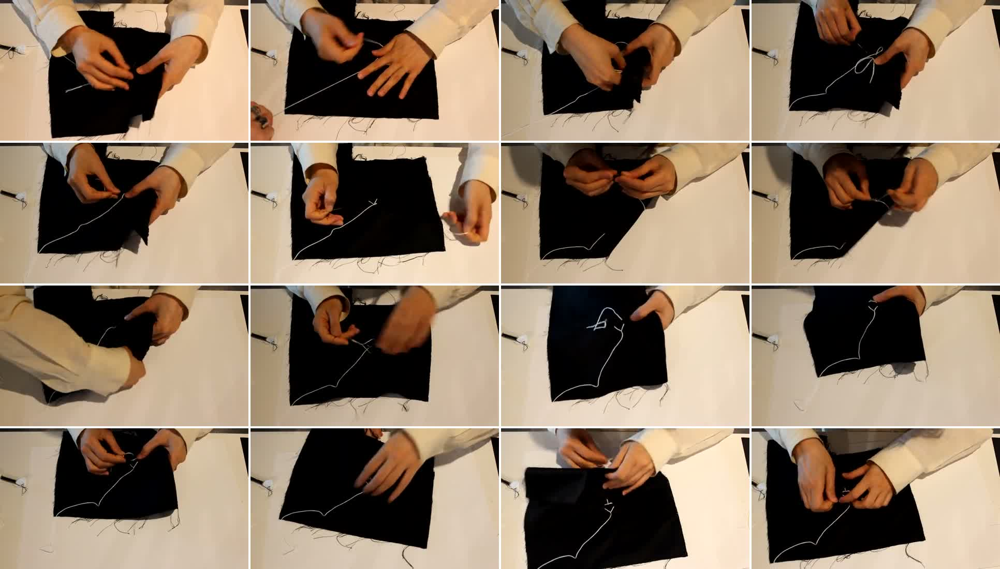
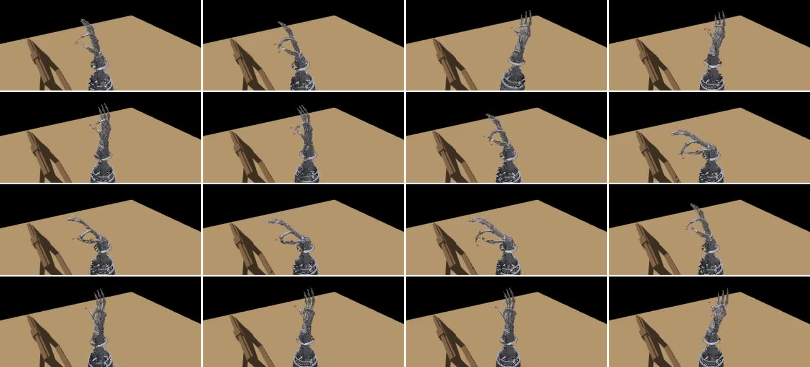
</p>
<sub>Left: own footage, one frame every 5 s. Right: the same clip retargeted in MuJoCo.</sub>

## Pipeline
footage → WiLoR (21 keypoints/frame + camera translation) → focal/scale correction → hand-size scaling → fingertip retargeting (scipy L-BFGS-B) + elbow/wrist from palm frame → reference clip (`refs/clip02.npz`) → RL tracking policy in MJX → real arm

<p>
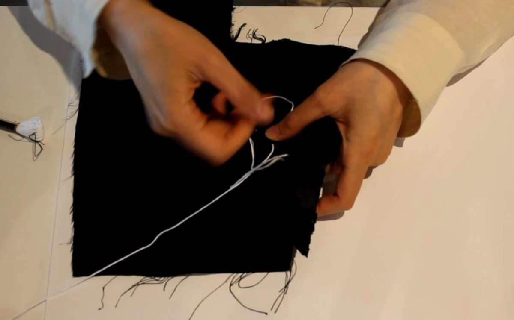
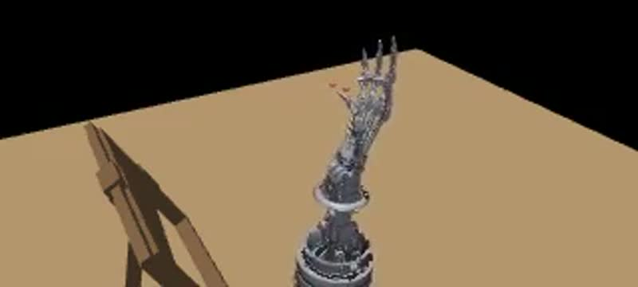
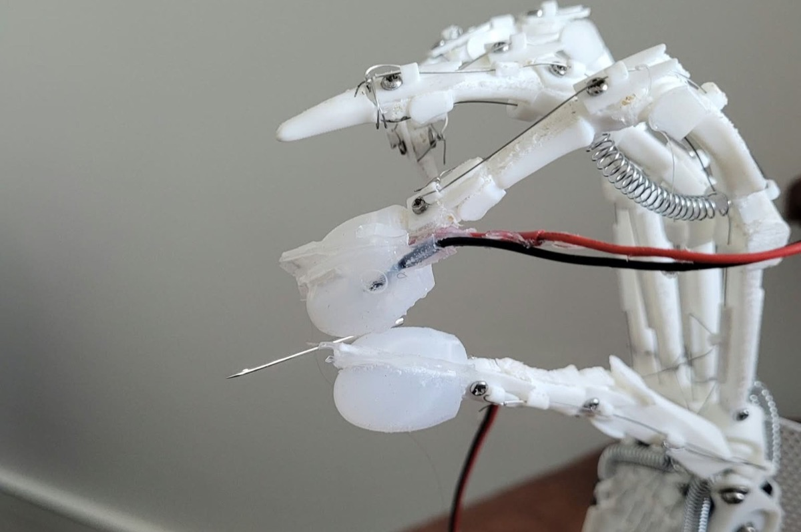
</p>
<sub>Own footage → retargeted in MuJoCo → real hand holding a needle</sub>

- **Camera scale.** A metre stick in the frame is clicked every 10 mm (`cam/object_estimation.py` → `stick_points.npy`); a least-squares fit recovers the real focal length (`cam/distance–compute.py`), used to correct WiLoR's camera depth (`DepthScale` in `arm.py`).
- **Scaling.** Human-to-robot finger scale is measured once from the clip (`retargeting/wlr_hand_to_robot.py` → `main_motion/scale_retarget.json`).
- **Fingers.** Per frame, thumb and index joint angles are optimised so the robot fingertips reach the scaled human fingertip targets, within joint limits (`retargeting/retargeting_sim.py`).
- **Elbow.** Follows the wrist's travel from the corrected camera translation, smoothed (median + Savitzky–Golay) and solved with law-of-cosines IK.
- **Wrist roll/tilt.** Taken from the palm frame (index MCP, pinky MCP, middle MCP, wrist), not full position IK, which was unstable on noisy WiLoR wrist estimates.
- **Grip detection.** Thumb–index tip distance in the footage flags frames where the needle is held.
- **Kinematics.** Forward kinematics built from the CAD joint frames with Rodrigues' rotation formula (`main_motion/f_kinematics.py`); law-of-cosines IK for the serial arm (`main_motion/i_kinematics.py`). Based on Jazar, *Theory of Applied Robotics*.

<p>
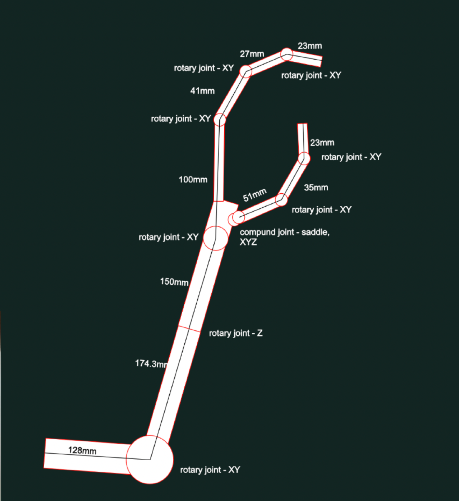
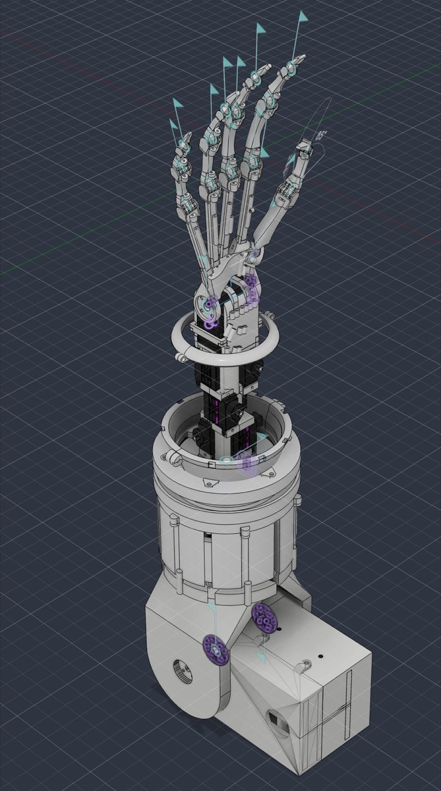
</p>
<sub>Kinematic chain with link lengths and joint types · joint frames in CAD</sub>

## Training (in progress)
`training/training_mjc.ipynb` builds an MJX environment (MuJoCo Playground style) on the robot's own model and trains it with Brax PPO.

- **Reference.** `refs/clip02.npz`: per-frame targets for 6 actuators (elbow pitch, forearm roll, wrist tilt, index MCP, thumb flexion, thumb adduction) at 30 Hz, written by `retargeting_sim.py`.
- **Action.** A residual on top of the reference: target = reference + action × per-joint scale, clipped to actuator limits. Scales come from the largest frame-to-frame jump in the clip.
- **Observation.** Joint positions and velocities, last action, and the gap to the next reference frame.
- **Reward.** Tracking (Gaussian on joint error) − action rate; episodes terminate on large tracking error. A pinch term is defined but not yet weighted.
- **Sensors.** `index_touch` / `thumb_touch` sites on the fingertip pads in the MJCF, mirroring the real pinch switch, plus a free-floating needle.
- Runs on Colab/Kaggle or an RTX machine.

## Results
<p>
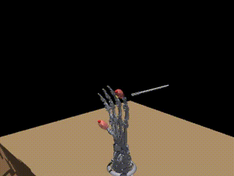
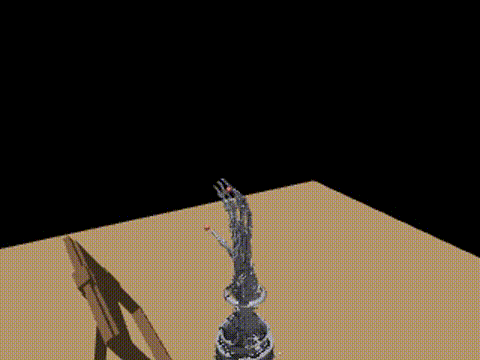
</p>
<sub>Left: needle grip in sim (`grip_sim.py`). Right: retargeted sewing motion (`retargeting_sim.py`).</sub>

- Retargeted elbow and wrist motion matches the footage in MuJoCo.
- Real arm: thumb–index pinch holds the needle and the pinch switch detects it.

## Quickstart
Run from the repo root (scripts import `arm.py` from there). The input clip is set by `NPZ_PATH` in `arm.py`; the bundled sample is `handsewing_01.npz`.
```bash
python3 -m venv .venv && source .venv/bin/activate
pip install -r requirements.txt
python -m main_motion.mjc_demo              # model sanity check → out.mp4
python -m retargeting.wlr_hand_to_robot     # hand-size scales → main_motion/scale_retarget.json
python -m retargeting.retargeting_sim       # solve + render → solved_angles_new2.npz, refs/clip02.npz, real_sim7.mp4
python -m retargeting.grip_sim              # needle grip in sim → grasp_sim.mp4
```
`retargeting/retargeting.py` is the same pipeline driving the real servos (Jetson, Linux).

Training needs JAX and MJX on top of the above:
```bash
pip install jax mujoco-mjx mujoco_playground brax ml_collections matplotlib
jupyter notebook training/training_mjc.ipynb
```

WiLoR is not bundled (MANO licence). To process new footage: install WiLoR, run `visualize_pose_videos.py --video <clip> --out_folder new_out`, then `glob_json.py` to build the `[frames, 21, 3]` keypoint array.

## Design choices
- **Fingertip targets over per-joint angle copying.** Copying human joint angles ignores the robot's different link lengths, so the pinch didn't close. Solving for fingertip positions preserves the pinch, which is what holds the needle.
- **Palm-frame wrist over full IK.** WiLoR's wrist position is estimated relative to the fingers and is noisy; full position IK jittered.
- **Five-finger hand, two-finger task.** The needle grip is a thumb–index pinch, so only thumb (flexion + adduction) and index are retargeted and learned.
- **Residual policy over learning from scratch.** The policy corrects a retargeted reference rather than discovering the motion, so it trains on one demonstration clip.
- **Pinch switch for needle detection.** A conductive-thread pad sits on the sensor side of each silicone fingertip cap, thumb and index pads facing each other, each wired to the Jetson. A held needle bridges the pads. A camera on the Jetson locates the frame.
- **One tendon per finger, spring return.** Each finger is flexed by a single Dyneema tendon through printed guides; extension springs open it again, so each finger needs one actuator.

<p>
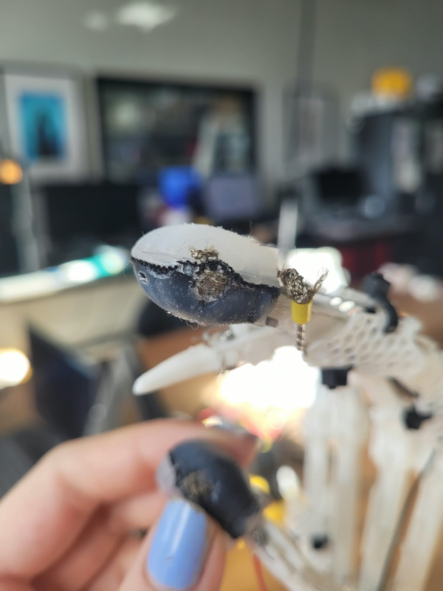
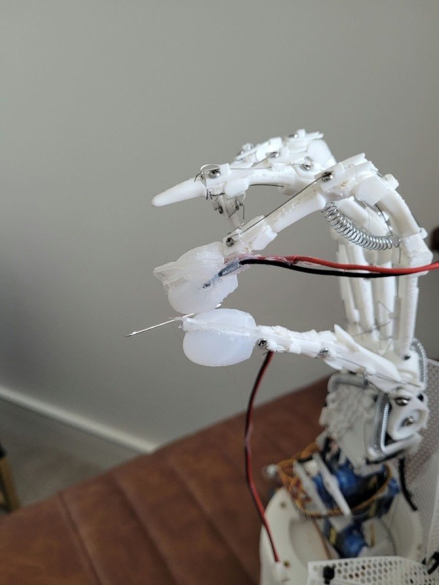
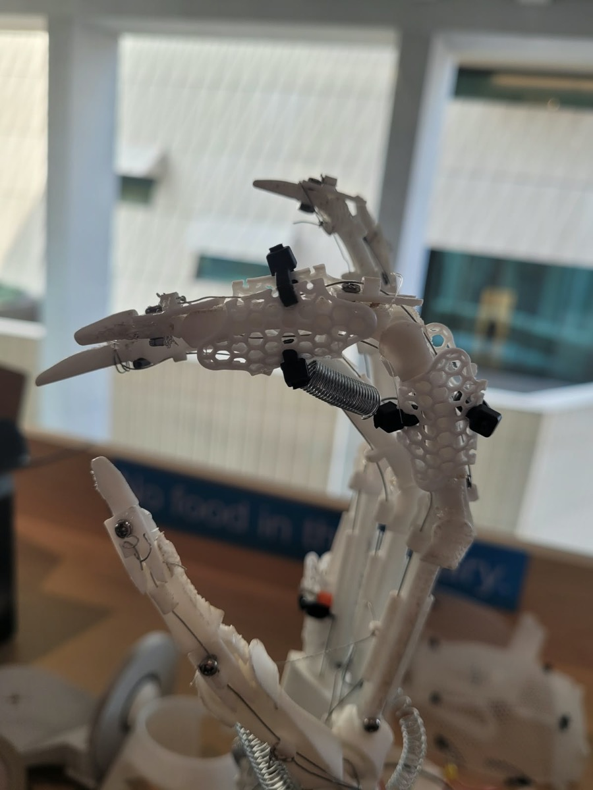
</p>
<sub>Conductive-thread pad in the silicone cap · needle held between the pads · spring return and tendon guides</sub>

## What didn't work
- **Per-joint angle mapping:** see above and `notes.md`.
- **IR sensing (ITR-9606) through the silicone caps:** signal too weak through the silicone (`itr_test.py`); replaced by the pinch switch.
- **Arm base lying on its side, as in the CAD:** sagged under load. Standing it on its face was also dropped; the base was redesigned around the elbow belt drive.
- **Long belt path on the elbow:** the elbow moved less than commanded; a tensioning bearing was added.
- **Dyneema creep:** tendons stretched over time, requiring re-tensioning and recalibration (`finger_calib.json`).
- **Manus mocap glove:** tried, replaced by WiLoR on my own footage.

## Limitations
- The policy covers thumb and index only. In the footage the middle finger also manages the thread and helps guide the needle; this is recorded as a process limitation.
- The elbow is gravity-limited: lifting from far past vertical overloads the servo (usable range ≈ 2850–3700 counts, vertical ≈ 3050).
- `notes.md` frame analysis describes the original clip; in the refilmed footage the needle mostly stays in hand.
- Joint damping/stiffness in the MJCF are not yet fitted to hardware.

## Hardware
- Jetson Orin Nano + Linux camera
- 3× ST3215 bus servos: wrist roll (ID 1), wrist tilt (ID 2), elbow (ID 3, 2:1 via HTD5M belt and 40T pulley, 8 mm shaft in bearings)
- PWM finger servos on a PCA9685 driver, one tendon each
- Silicone fingertip caps with conductive-thread pads
- 3D-printed arm, base and hand (STLs in `model/meshes/`)

<p>
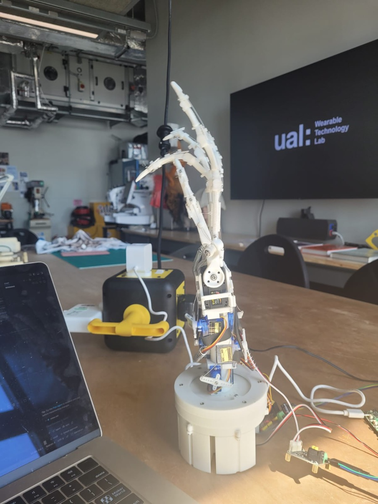
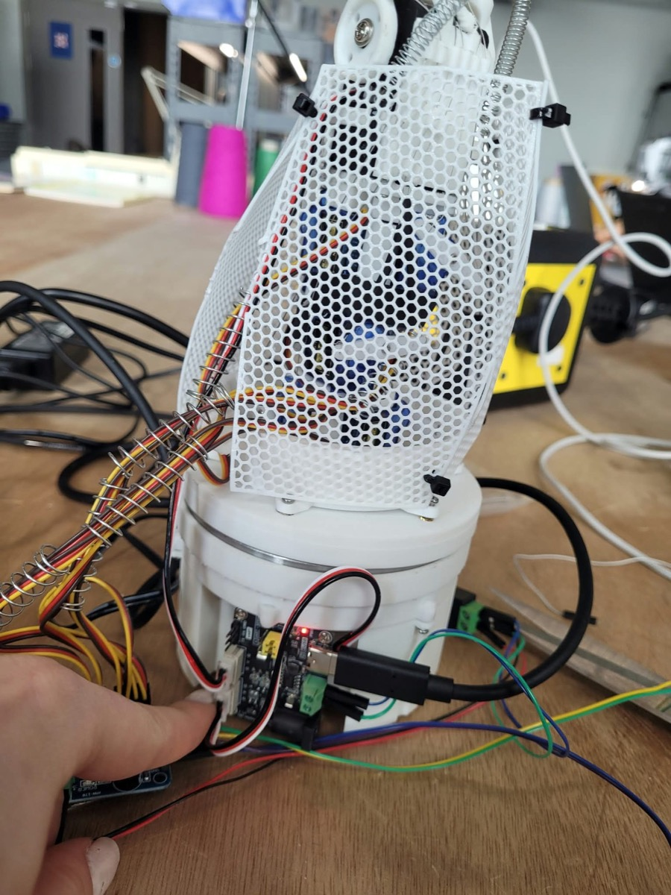
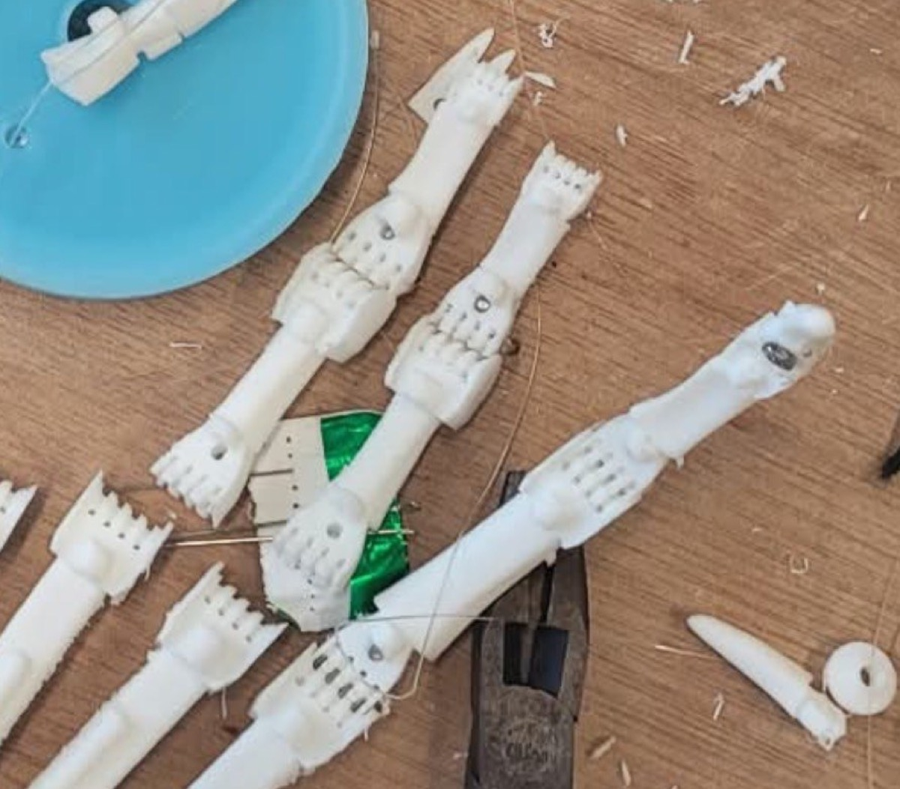
</p>
<sub>Assembled arm · electronics in the forearm · printed finger parts</sub>

## Repo map
| Path | Contents |
|---|---|
| `arm.py` | Core classes: ST and PWM servos, calibration, hand pose, depth scaling, arm IK, MuJoCo wrapper, camera |
| `retargeting/` | Hand-size scaling, retargeting (sim and real), needle-grip sim |
| `training/` | MJX training environment and PPO policy notebook |
| `refs/` | Reference clips for training (`clip02.npz`) |
| `main_motion/` | Forward/inverse kinematics, MuJoCo demo and joint map, grasp tests |
| `main_motion/MJC/` | MuJoCo Playground / Brax reference example |
| `main_motion/calib/` | Joint limits, angle mapping, position logging against video |
| `model/` | MuJoCo MJCF (`palm_with_frame.xml`) and STL meshes |
| `cam/` | CSI camera setup, checkerboard and metre-stick calibration, object/needle estimation |
| `scservo_sdk/` | Vendored Feetech SDK for the ST3215 servos |
| `visualize_pose*.py`, `glob_json.py`, `angle_computation.py` | WiLoR processing and angle extraction |
| `finger_calib.json` | Finger calibration from grasp tests |
| `notes.md` | Development log |
| `retired/` | Superseded approaches, including early servo setup scripts |

## Credits
WiLoR (hand pose). MuJoCo, MJX, MuJoCo Playground and Brax (simulation and PPO). Jazar, *Theory of Applied Robotics*. Minimiser setup after Aleksandar Haber; camera scripts adapted from Pysource and Automatic Addison (credited in file headers). AI was used for explanations and as a diagnostic tool when I was stuck; all code was written by me (see `notes.md`).
